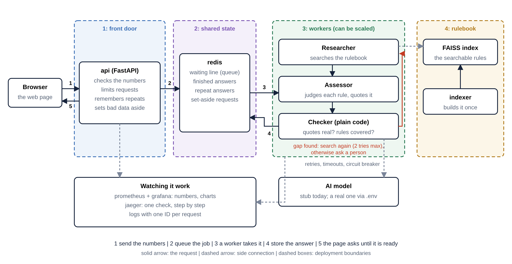

# Building Plan Compliance Pre-Check: report

ML System Design and AgentOps (UE24AM342AA5), Mini Project 05. Edit names, add your team, and rewrite in your own words where you like. Every number below comes from a run in this repository; where a number is a prediction or comes from the stand-in model, it says so.

## 1. Problem and scope

An architect's office checks a plan against the building bye-laws before sending it to the city. One broken rule means the plan comes back and weeks are lost. The rules are not a checklist: many limits depend on two or three other numbers at once (plot size, road width, height, zone, use). A plan that passes at 9 m can fail at 10 m.

**What the service does.** It takes a building proposal as structured numbers plus free-text notes, checks the numbers make sense, finds the bye-law rules that apply, compares the proposal to each rule, double-checks its own answer against the rule text, and returns one of three outcomes: `clear-for-submission`, `revise-and-recheck` or `specialist-review`, with the reason and a quoted clause for every finding.

**What it never does.** It never certifies a plan. "Clear" means "no broken rule found", and the screen says a licensed professional must still sign off. When it is unsure it hands over to a person instead of guessing.

**Out of scope (as the brief says).** Reading drawings or PDFs of plans, model training, cloud deployment.

**The hard case (brief section 4.1).** A small plot on a narrow road. The gap table (Table 8) gives the gap to leave at the front. The height limits (12 m on plots up to 250 sq m, 15 m on roads under 9 m) are stated in separate notes that the table never mentions. A single search finds the table and misses the height rule, so a naive system reports "no height problem". This case drives the design.

**Corpus.** The corpus is real regulation text: Table 8, the height notes and rule 4.1.2(b) from the Bengaluru Zonal Regulations Amendment 2025, and extracts of the Karnataka Model Building Bye-Laws 2017 (stilt floor, high-rise, lifts, setback definition). **What the documents do not contain:** Table 9 (gaps above 12 m), Table 10 (floor area and coverage), parking norms and other zones. The bye-laws leave those numbers to the zonal regulations. So taller buildings and non-residential plans go to a person, and floor area, coverage and parking are reported as "Not checked". A "clear" result means only that none of the rules we hold is broken.

## 2. Agent design

### Topology

A supervisor graph (LangGraph) runs these steps: **classify, research, assess, verify, route**, with a retry edge from verify back to research.

| Agent | Job | Tools it can choose |
|---|---|---|
| Researcher | Find every rule that binds this proposal | `search_corpus`, `get_clause`, `get_request_field` |
| Assessor | Compare the numbers to each retrieved rule and write a finding with a verbatim quote | none; it only sees what the Researcher found |
| Checker (verifier) | Plain code, not a model. Every citation resolves to a retrieved passage; every quote is word for word in it; required rule families were covered | none |

**Hand-off.** The Researcher passes the set of retrieved passages to the Assessor. The Assessor can only cite those. That is what stops it inventing a rule.

**Why two agents and a checker, not one.** One agent that searches and judges can talk itself into an answer from a half-read table. Splitting the job gives each part a single responsibility that can be tested alone, and lets the judge's evidence be audited by code. The Checker is deliberately *not* a model, so it cannot be argued with.

### Verification and what it checks

- Every finding must cite a passage that was actually retrieved.
- The quoted text must appear verbatim in that passage.
- Coverage: for a proposal with a setback question there must be a retrieved *and cited* rule on height by road width (and vice versa). If not, verification fails with a message naming the gap, and the Researcher searches again with that hint.
- After `MAX_VERIFY_ATTEMPTS` (2) failures the run escalates to a person. An unverified result returns **no findings**.

### Loop limits

`MAX_STEPS` 8, `MAX_TOOL_CALLS` 8, `MAX_RUN_SECONDS` 90, `MAX_VERIFY_ATTEMPTS` 2. These exist because agents multiply model calls and free tiers have low rate limits.

### When it hands over to a person (F7)

Rules conflict; an exemption may apply (for example a very small plot); the proposal is outside the rulebook (for example a non-residential use the sample does not cover); the double-check failed twice; the notes contain an injection attempt; the AI service was unreachable (degraded fallback).

### How the pieces fail

| If this fails | What happens |
|---|---|
| AI provider slow or erroring | Timeouts, up to 3 retries with exponential backoff; then a circuit breaker opens after repeated failures and stops calling it |
| Breaker open, or time budget gone mid-run | The supervisor goes to a `degraded` path: fixed retrieval from the request's own fields, outcome `specialist-review`, no findings asserted |
| A worker crashes mid-run | The API stays up. The run is marked failed with a safe escalation result (if the worker survives) or stays `running` (known gap, runbook has the manual re-queue) |
| Corrupt job in the queue | Marked failed; worker carries on (tested) |
| Redis hiccup | Worker logs, waits 1 s and retries instead of exiting |
| Tracing backend unreachable | Tracing is optional and never blocks a request (tested) |

## 3. Data and retrieval (L1, D2)

- **Chunking.** Clause-level: one chunk per clause; for tables, one chunk per row with the table title repeated so a row still makes sense alone. Reason: the rules are table rows selected by plot size and road width, and a chunk that loses its table title is unusable.
- **Embeddings.** Local `sentence-transformers` (all-MiniLM-L6-v2), no paid API. Cached by `sha1(model + text)`, so changing the rulebook only embeds new text.
- **Index.** FAISS, built by a one-shot `indexer` service. Idempotent: running it again changes nothing if the corpus is unchanged. Metadata records the build time and version (shown by `/health` and `precheck.cli index-info`).
- **Retrieval** is a tool the Researcher chooses to call, not a fixed first step.

## 4. Serving and platform

- **FastAPI**, asynchronous: `POST /v1/runs` returns 202 and a run id; the client polls `GET /v1/runs/{id}`. Runs take several seconds to tens of seconds, so this keeps request latency independent of provider latency.
- **Redis** holds the queue, run state, the whole-run cache and rejected requests.
- **Workers** are separate containers: `docker compose up --scale worker=3` works, and each worker can run several checks at once (`WORKER_CONCURRENCY`).
- **Data contract** (`GET /v1/contract`): types, ranges, categories and cross-field rules (for example height per floor must be plausible; total floor area cannot exceed plot area times floors). Bad requests get 422 with field-level errors and are quarantined, never queued.
- **Configuration**: everything environment-specific, including endpoints and model names, comes from `.env`. Nothing is hard-coded in the repository.
- **Nine services** under one `docker compose up`: redis, llm-stub, indexer, api, worker, prometheus, grafana, jaeger, plus an on-demand `eval` tool.

### Deployment boundaries (where they are and why)

1. **Front door (api).** Cheap, stateless, must stay up when workers are busy or crashed.
2. **Shared state (redis).** The only stateful link between api and workers.
3. **Workers.** Heavy (model and index in memory), slow, scale with the number of checks, isolated so a bad run cannot take down the front door.
4. **Rulebook (indexer and index).** Released independently: re-index without redeploying the serving path.

## 5. Safety (L4)

- Instruction-like text in the notes is detected; the notes are discarded and the case escalates. Notes are also wrapped as untrusted data in the prompt.
- A small word-list screen flags abusive notes (heuristic; a stronger classifier is an upgrade).
- An output filter blocks "compliant", "approved" and "certified" language, so the system cannot issue an approval.
- Harmless notes do not trigger any guardrail (tested as scenario s18).

## 6. Evaluation (L2, L3, L6)

**Evaluation set.** 27 scenarios in `eval/scenarios.jsonl`: 17 normal proposals (including boundary values exactly at a limit and a plot bigger than the rulebook covers), 1 harmless-notes case, 2 injection attempts, 1 abusive-notes case, 6 invalid requests. Expected outcomes come from `eval/reference.py`, an independent answer key written in plain code from the rule numbers, so the system does not grade itself.

**Metrics** (computed in plain code from the rule text, so they need no judge model; they mirror TruLens' RAG-triad ideas, but TruLens itself is not installed): route accuracy; violation recall and precision; context recall (the rules that apply were really retrieved); groundedness (every quote is verbatim from the rule it cites); guardrail catch and false positive rates; invalid-request rejection; average tool calls, seconds, tokens and cost.

**Before and after (the change under test: the agent loop).** The baseline allows the Researcher only one tool call. The agent loop allows up to 8.

| Metric | Baseline (one search) | Agent loop |
|---|---|---|
| Scenarios passed | 16 of 35 | 35 of 35 |
| Route accuracy | 0.27 | 1.00 |
| Violation recall | 0.00 | 1.00 |
| Violation precision | n/a | 1.00 |
| Context recall | 0.31 | 1.00 |
| Groundedness | n/a (nothing returned) | 1.00 |
| Escalation rate | 1.00 | 0.27 |
| Wrong confident answers | 0 | 0 |
| Average tool calls | 1.0 | 7.0 |
| Average tokens | about 2,800 | about 14,600 |

Reading: with one search, the system escalates every normal case and finds none of the violations, so it never answers wrongly but is useless. The loop costs about 5 times the tokens and gets everything right. **Caveat:** these results come from the scripted stub model and a simple offline stand-in for the embedding model, on the real rule text. They show the system is built correctly; they do not show how the real model behaves, or whether the real embedder retrieves the right Table 8 row.

**Prompt versions (L2).** Two versions exist (`prompts/v1`, `v2`), the version is recorded with every answer, and the harness can compare them (`PROMPT_VERSION=v1` then `v2`, same eval set). **Not yet done:** the stub ignores prompt wording, so the two score the same; the comparison needs a real model. Fill in here: which version won, on which metric, by how much.

**Live quality scoring (L6).** A configurable share of real runs (`SCORE_SAMPLE_RATE`) is scored automatically with the same groundedness, citation and coverage checks, and charted in Grafana; `GET /v1/quality/summary` aggregates it. Users can also mark a result useful or not with a reason (`POST /v1/runs/{id}/feedback`), persisted and aggregated.

## 7. Operations

- **Logs:** structured JSON, one line per event, each with a correlation ID carried across api, queue, worker and every agent step.
- **Metrics:** Prometheus; a Grafana dashboard (30 panels) shows, per agent: model calls, steps and tool calls per check, time per step, end-to-end time, queue depth, retries, breaker state, tokens and cost, double-check results, why runs were sent to a person, guardrail hits, and sampled quality.
- **Tracing:** OpenTelemetry to Jaeger. One trace per request, continuing across the Redis queue into the worker via the W3C `traceparent` header, with a span per agent step, model call and tool call.
- **Alerts** (`prometheus/alerts.yml`): worker down or restarting, queue growing, AI provider cut off, checks failing, slow checks, quality dropping. Each links to a runbook section.
- **Runbook:** `docs/RUNBOOK.md`. **Incident log:** `docs/INCIDENTS.md` (INC-001 below).

**INC-001, worker crash loop.** On the first real `docker compose up`, the worker restarted every 10 seconds with `redis.exceptions.TimeoutError`. Cause: the worker waits for jobs with `BLPOP` for 5 seconds, and the Redis client's default socket timeout is also 5 seconds, so an idle worker timed out at the same instant. Fix: socket timeout 30 s plus connect timeout, health check and error-tolerant loop. A regression test pins it. It was found by reading logs; the alert `WorkerFlapping` now exists so it would be found without reading logs.

## 8. Speed target and load test (D6, A7)

**Target, declared before measuring** (see `docs/SLO.md`): p95 of a complete run (submission to stored result, including queue wait) of **45 s or less with 10 people at once and 3 worker slots**; 99% of checks finish; 100% of returned findings are grounded.

**Measured** (full table and method in `docs/SLO.md`). Local rig without Docker, 2 cores, stub model at 1.5 s per call, hashed embedder, 10 simulated people, 180 s per setup, 0 failures in all 208 checks:

| Setup | Slots | p50 | p95 | Target met? |
|---|---|---|---|---|
| 1 worker x 1 thread | 1 | 75 s | 108 s | No |
| 3 workers x 1 thread | 3 | 31 s | 41 s | Yes, narrowly |
| 1 worker x 4 threads | 4 | 20 s | 31 s | Yes |

**Bottleneck.** Waiting for the AI model: each check is 7 model calls in a row, so one check holds a slot for about 11 s even though our own code uses a fraction of that. Time to answer follows `people / slots x 11.5 s`, which is what we predicted before measuring. More slots (threads or workers) fix it until CPU becomes the limit. **Before and after:** going from 1 slot to 3 cut p95 from 108 s to 41 s and raised throughput 3.5 times (20 to 70 checks in the same time). **Caveats:** stub model, no Docker and no real embedding model, so re-run on the demo machine; with a real provider, latency and rate limits will change the numbers.

## 9. Caching and rate limiting (D7)

- **Embedding cache** (by hash of model and text): re-indexing unchanged text costs no embedding time.
- **Whole-run cache:** an identical proposal (same numbers, same notes, same prompt version) is answered instantly without a worker. Keyed with the prompt version so a prompt change never serves old answers. Justification: architects resubmit near-identical plans while tuning one number, and exact repeats are common.
- **Rate limit:** per client (`X-Client-Id`, default 10 a minute), so one client cannot use up the provider's free-tier limits.

## 10. Cost (L5)

Prompt tokens, completion tokens and cost are recorded at the time of each call and attributed per step and per run (`precheck_llm_cost_usd_total`, Grafana "Cost per check"). With the stub the price is zero, so cost is a formula until a real model is plugged in:

cost per 100 runs = 100 x (average prompt tokens x prompt price + average completion tokens x completion price)

Average tokens per run on the evaluation set: about 7,800 (agent loop). **Fill in** with the real provider's prices after one real-model run. Cache hits cost nothing.

## 11. Design decisions and what was rejected

| Decision | Chosen | Rejected, and why |
|---|---|---|
| Orchestration | LangGraph supervisor graph with an inner research loop | CrewAI: less control over the loop and the retry edge; one big prompt: no way to bound steps or audit evidence |
| Verification | Plain-code checker | A second model as judge: costs more, can be wrong the same way, and cannot be tested exactly |
| Retrieval | Agent-chosen tool, clause-level chunks, local embeddings | Fixed top-k search before the agent: that is the baseline that misses the height rule; paid embedding API: real cost for no gain |
| Vector store | FAISS (in the worker's memory) | Chroma/a database service: one more service to run for a corpus this small |
| Queue | Redis list | Celery/RabbitMQ: heavier for a single job type; a list is enough and is also the cache and state store |
| Reply style | 202 + poll | Holding the request open for tens of seconds: ties up the front door |
| Answer style | Never certify; escalate | Always answering: easy to build, but wrong answers are worse than a hand-over |
| Quality metrics | Deterministic, from rule text | LLM-as-judge: costs model calls on every scored run and adds its own error |
| Explanations | Built from the numbers in plain code | Free-text from the model: can misstate a number |

## 12. What did not work, or is not done

- **Worker crash loop** on first run (INC-001), described above.
- **A too-clever exemption detector** matched ordinary text and escalated normal cases; removed in favour of an explicit small-plot rule.
- **The first baseline numbers were misleading** until the answer key was written independently of the system.
- **Not done:** Table 9, Table 10, parking norms and other zones (not in the documents supplied); real-model runs, so the prompt v1/v2 comparison and real cost numbers are open; the speed numbers below come from a local rig with the stub model, not Docker on the demo machine; a job whose worker is killed mid-run can stay `running` (no reliable queue); the toxicity screen is a small word list; TruLens is not installed; the checker reads the form's numbers only, not drawings.
